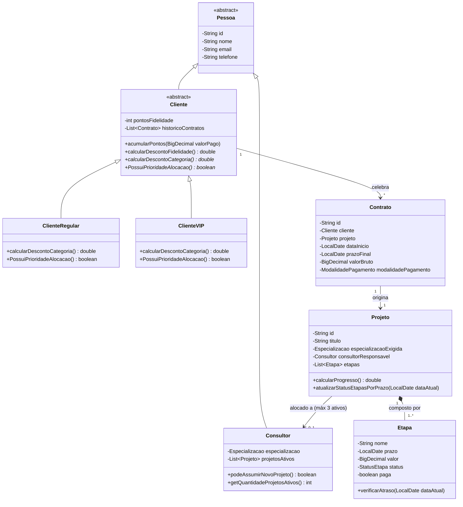

# Modelagem e Arquitetura Planejada — Planilha Certa

Este documento descreve o esqueleto arquitetural e a modelagem Orientada a Objetos planejada para o sistema de gestão da consultoria **“Planilha Certa”**, com base no enunciado `S10a - Gestão de Consultoria.docx.pdf` e nas diretrizes do `Trabalho P2.pdf`.

---

## 1. Arquitetura em Camadas (Pacotes)

O projeto está estruturado sob o pacote base `br.com.planilhacerta`:

- **`model/`**: Classes de domínio, classes abstratas, interfaces e enumerações que representam o negócio da consultoria.
- **`repository/`**: Interfaces e implementações responsáveis pela leitura e gravação dos dados em arquivos (`CSV`, `JSON` ou `TXT`).
- **`service/`**: Lógica de negócio, validações, regras de alocação automática de consultores, cálculo de progresso de projetos, faturamento com descontos e programa de fidelidade.
- **`view/`**: Interface de interação com o usuário (menus de console ou telas), tratando entradas inválidas sem interromper a execução.
- **`util/`**: Utilitários de data/prazo, geradores de relatório (console / PDF via *iText*) e classes de exceções customizadas.

---

## 2. Entidades e Enumerações Planejadas (`model`)

### Enumerações Previstas
- `CategoriaCliente`: `REGULAR`, `VIP`.
- `Especializacao`: `FINANCEIRO`, `GESTAO`, `TI`.
- `StatusEtapa`: `PENDENTE`, `EM_ANDAMENTO`, `CONCLUIDA`, `ATRASADA`.
- `ModalidadePagamento`: `POR_ETAPA`, `ENTREGA_FINAL`.

### Hierarquia de Classes e Aplicação de POO

---

## 3. Regras de Negócio Principais (`service`)

1. **Alocação Automática de Consultores (`AlocacaoService`)**:
   - Filtra consultores pela `Especializacao` exigida pelo projeto (`FINANCEIRO`, `GESTAO` ou `TI`).
   - Descarta consultores que já possuam **3 projetos ativos** (limite máximo).
   - Seleciona o consultor com o **menor número de projetos ativos**.
   - Caso haja fila ou disputa de alocação, projetos vinculados a `ClienteVIP` possuem **prioridade**.

2. **Controle de Etapas e Progresso (`ProjetoService`)**:
   - Cada etapa possui prazo e valor próprios.
   - Se a data atual ultrapassar o `prazo` e o status não for `CONCLUIDA`, o status passa a ser `ATRASADA`.
   - O progresso do projeto é calculado por:
     $$\text{Progresso (\%)} = \left(\frac{\text{Quantidade de Etapas Concluídas}}{\text{Total de Etapas do Projeto}}\right) \times 100$$

3. **Faturamento e Descontos (`FaturamentoService`)**:
   - Permite faturar individualmente cada etapa concluída (`POR_ETAPA`) ou o valor integral na conclusão do projeto (`ENTREGA_FINAL`).
   - Aplica **10% de desconto** nas faturas de `ClienteVIP`.
   - Aplica desconto do programa de fidelidade em novos contratos: **5% a cada 100 pontos**, limitado a **15%**.

4. **Programa de Fidelidade e Recomendações (`FidelidadeService`)**:
   - Concede **1 ponto a cada R$ 100,00 pagos**.
   - Analisa o histórico de projetos/contratos do cliente e identifica quais especializações (`FINANCEIRO`, `GESTAO`, `TI`) ele **ainda não contratou**, gerando recomendações personalizadas (incluídas também nos relatórios de clientes VIP).
